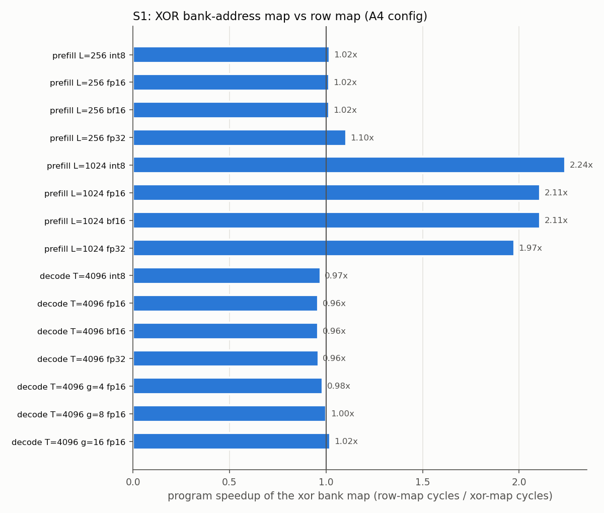
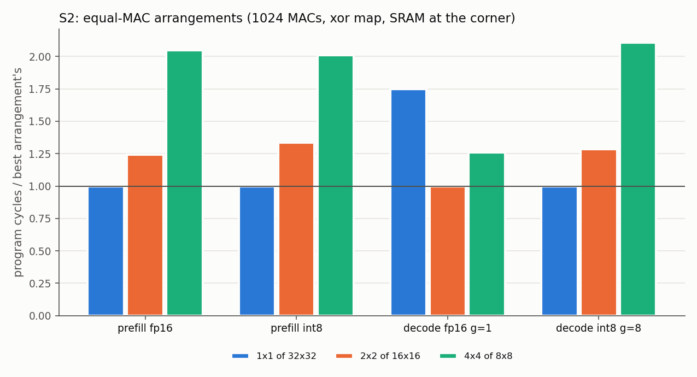

# Results

Every number here comes from a generated file under `results/`, and
`scripts/check_results.sh` verifies each one (rule 1). Each results file
begins with its own provenance block: commit, clean tree, machine and tool
versions. This is a model of no real chip. The numbers describe this model
with these modelling parameters.

Phases 1 and 2 have no hypotheses beyond "the hand derivations hold". Their
exit criteria are in [results/phase1](results/phase1) and
[results/phase2](results/phase2) (all hand-derived values matched; 200 of 200
random GEMMs bit-exact).

## Phase 3: accelerator grid, stall stack, roofline

Measured at commit 0d8ce61 by `scripts/phase3_results.sh`. Sources:
[exit_criterion.txt](results/phase3/exit_criterion.txt),
[sweep.csv](results/phase3/sweep.csv),
[functional_accel.csv](results/phase3/functional_accel.csv),
[mutation_check.txt](results/phase3/mutation_check.txt).

### Directed tests (hand-derived in the design note before running)

| Test | Hand-derived | Measured |
|---|---|---|
| P3-T1, one PE at the SRAM node: T_end | 192 | 192 |
| P3-T1 stall stack (compute / dram / network / dma / idle) | 86 / 52 / 7 / 27 / 20 | 86 / 52 / 7 / 27 / 20 |
| P3-T2, PE one hop away, second PE idle: T_end | 272 | 272 |
| P3-T2 stall stack of PE 0 | 86 / 52 / 65 / 49 / 20 | 86 / 52 / 65 / 49 / 20 |
| P3-T2 PE 1 idle | 272 | 272 |
| P3-T3, 2×2 grid: DRAM bytes (staging formula) | 24576 | 24576 |

Both build presets (Release and ASan/UBSan) pass all 79 tests with no
mismatches. All 100 random grid GEMMs agree bit-exactly between the model,
NumPy and the C++ reference, including 11 all −128 cases.

### Exit criterion: stall-stack assertions over the sweep

All 115 configurations ran. In every run, the model's own assertions held:
- per-PE stacks summed to T_end and the chip stack to P·T_end;
- compute cycles equalled the tile-latency formula;
- DRAM bytes equalled the staging formula;
- the classifier never met an unexplained stall.

The sweep added three more checks, which also held in every run:
- DRAM bytes = the Python formula count;
- achieved ≤ attainable;
- the simulator's busiest link was busy at least `B_max / L` cycles.

In total, 2778141 PE-cycles were classified, with zero failures.

### Hypotheses (written in the design note §8 before measuring)

**H1: every run satisfies the assertions, and achieved ≤ attainable.**
**Confirmed.** All 115 runs, zero failures (above).

**H2: the dominant stall matches the predicted roofline region.**
**Partly refuted.**

| Predicted region | Configs | Expected stall wins | Others |
|---|---|---|---|
| compute | 37 | compute largest in 34 | idle 2, dram 1 |
| DRAM | 52 | dram the largest non-compute stall in 28 | idle 14, dma 10 |
| NoC | 26 | network the largest non-compute stall in 12 | idle 8, dram 3, dma 3 |

The formula region is right about which ceiling is lowest. It is often
wrong about what the PEs actually wait on.
- **idle:** synchronization on the staging ring, partial waves, and the
  write-back epilogue. These matter most in short-K configurations.
- **dma:** the on-chip fetch latency (SRAM access, mesh responses arriving
  at the DMA, LMEM writes). It is not a bandwidth ceiling, so a roofline
  cannot predict it.

Example, config 4 (16×16 arrays, 2×2 grid, W = 64, L = 64):
- predicted DRAM-bound, at 0.5290 of its DRAM ceiling;
- its largest non-compute stall is `dma`, not `dram`.

**H3: compute-bound §4.1 configs reach ≥ 75 % of peak at K = 1024.**
**Refuted.** Both compute-bound §4.1 configurations fall short:

| Config | Achieved / peak | Largest non-compute stall |
|---|---|---|
| 0 (4×4 arrays, 2×2 grid, W = 64, L = 64) | 0.7320 | dram |
| 2 (8×8 arrays, same system) | 0.7019 | dma |

I underestimated the staging prologue and the per-chunk fetch latency. The
fill/drain term alone (F ≤ 46 cycles against 1024 feed cycles per tile) was
not the main loss.

**H4: DRAM-bound configs reach ≥ 50 % of their DRAM ceiling.**
**Confirmed** for both §4.1 DRAM-bound configurations:
- config 1 (8×8, W = 16): 0.8251;
- config 4 (16×16, W = 64): 0.5290, only just over the line.

**H5: moving the SRAM from the corner to the centre of a 3×3 grid raises
throughput in NoC-bound configs.**
**Confirmed** for all three array sizes (achieved ops/cycle):

| Array | Corner | Centre |
|---|---|---|
| 4×4 | 93.6377 | 138.3265 |
| 8×8 | 188.6230 | 369.0725 |
| 16×16 | 377.5704 | 745.4626 |

The centre has four egress links instead of two, so the formula NoC ceiling
also rises: 384.0000 → 768.0000 ops/cycle for 16×16. With the 4×4 array, the centre placement
lifts the configuration far enough that the NoC is no longer its largest
stall. Compute is (config 6).

### What looked too good, and why it holds

NoC-bound runs reach up to 0.9833 of their NoC ceiling (config 9). Under
the project rules that is a suspect until checked. The sweep's link
cross-check explains it:
- the simulator's busiest link was busy 49536 cycles out of T_end = 49989;
- that is the formula's data bytes plus the one-cycle write acknowledgements
  on the same link.

So the link really is saturated. The mutation check also shows the stall
checks can fail: all 8 mutants were caught, including a classifier that
charges the fill/drain tail as idle (caught only by the compute
cross-check) and a scheduler that stages each block twice (caught by the
DRAM-bytes assertion).

Across all runs, efficiency against the attainable ceiling ranges from
0.2246 to 0.9847 (median 0.6165).

## Phase 4: precision modes, vector unit, attention

Measured at commit 84a082a by `scripts/phase4_results.sh`. Sources:
[exit_criterion.txt](results/phase4/exit_criterion.txt),
[study.csv](results/phase4/study.csv),
[functional_gemm.csv](results/phase4/functional_gemm.csv),
[functional_attn.csv](results/phase4/functional_attn.csv),
[mutation_check.txt](results/phase4/mutation_check.txt).
The reference configuration (A4) is a 2×2 grid of 16×16 arrays with
W = 64 B/cycle DRAM. All workloads use head dim 64 and one KV head
(design note §8.4).

### Directed tests (hand-derived in the design note before running)

| Test | Hand-derived | Measured |
|---|---|---|
| P4-T1, FP16 GEMM: T_end | 316 | 316 |
| P4-T1 stall stack (compute / dram / network / dma / idle) | 150 / 92 / 7 / 47 / 20 | 150 / 92 / 7 / 47 / 20 |
| P4-T2, FP32 GEMM: T_end | 564 | 564 |
| P4-T2 stall stack | 278 / 172 / 7 / 87 / 20 | 278 / 172 / 7 / 87 / 20 |
| P4-T3, BF16: same as FP16 | 316, 2816 B | 316, 2816 B |
| P4-T4, masked write-back: T_end, DRAM bytes | 186, 1344 | 186, 1344 |
| P4-V1, VU 2 rows: T_end FP16 / INT8 / FP32 | 84 / 82 / 88 | 84 / 82 / 88 |
| P4-V2, VU two P segments: T_end | 84 | 84 |

Both presets pass all 113 tests. All of the following are bit-exact three
ways (model, NumPy replica, standalone C++ reference):
- 200 random grid GEMMs, 50 per precision, including 25 large-magnitude
  cases;
- 80 random attention programs, 8 per mode × precision combination;
- all 54 study programs.

All 11 mutants were caught. For example, a fused multiply-add in the FP32
accumulator is caught only by the FP32 functional cases and a hand case;
the other precisions are immune because their products are exact.

### Hypotheses (written in the design note §10 before measuring)

**H1: hand derivations hold, everything is bit-exact, BF16 timing equals
FP16.** **Confirmed** (above).

**H2: lower precision speeds up prefill sub-linearly. Prediction at
L = 1024: FP16/INT8 in [1.3, 1.8], FP32/FP16 in [1.4, 1.95].**
**Refuted.** It is far more sub-linear than predicted, and for a reason the
prediction missed.

| Prefill L = 1024 | Measured | Bound-based prediction |
|---|---|---|
| FP16 / INT8 time | 1.0965 | 1.5214 |
| FP32 / FP16 time | 1.2550 | 1.6857 |

Precision barely matters because the Q·Kᵀ op dominates and is limited by
DRAM row misses, not by compute or bandwidth.
- **INT8:** Q·Kᵀ takes 1402154 of 1700845 cycles. 68928 of its 131072
  DRAM accesses are row misses, and the DRAM bus is busy only 0.0935 of
  the time.
- **Cause:** the S write-back is row-major with a row stride of
  4·L = 4096 B, exactly banks × row size. Every row of an output tile
  therefore lands in the same DRAM bank, in a different row, and the
  in-order FCFS controller (Phase 1, no reordering, no write buffer)
  serializes the misses.
- **Contrast:** P·V writes only a small O and stays near its bounds. At
  L = 256 the stride is a single DRAM row and the effect is much weaker.
- **What it shows:** the model's simplest DRAM component decides the
  headline number. The first Phase 5 exploration should be the
  controller (FR-FCFS, write buffering, bank hashing) or a tile-major S
  layout.

**H3: unfused softmax is ≥ 15 % of prefill at L = 1024 in every precision,
largest at INT8.** **Refuted.** The shares are 0.0997 (INT8), 0.1406
(FP16/BF16) and 0.1967 (FP32), and the share is largest at FP32. The
inflated Q·Kᵀ op shrinks every other share. FP32 is above the line
because its S read and P write are the largest.

**H4: decode Q·Kᵀ at INT8 is array-bound, not memory-bound.**
**Confirmed.** At T = 4096 the op's largest stall category is `compute`:
28160 PE-cycles, against 737 `dram` and 4311 `dma`. The formula roofline,
which counts only useful (unpadded) ops, predicts this op to be DRAM-bound.
The array instead spends its time on tiles that use 1 of 16 rows and pay
the fill/drain on every 64-step tile.
- **Beyond the hypothesis:** FP16 and FP32 also have `compute` as the
  largest category (44544 and 77312 PE-cycles). I had expected FP32 to be
  DRAM-bound.

**H5: grouped-query attention is nearly free on this array. T(g)/T(1) at
T = 4096, FP16: ≤ 1.25 for g ≤ 8, ≤ 1.6 for g = 16.** **Refuted.**

| g | T(g)/T(1) FP16 | per query head | Q·Kᵀ row misses | Q·Kᵀ bus busy |
|---|---|---|---|---|
| 1 | 1 | 1 | 759 | 0.7463 |
| 4 | 1.7074 | 0.4269 | 1664 | 0.3697 |
| 8 | 2.6095 | 0.3262 | 2704 | 0.2412 |
| 16 | 4.4110 | 0.2757 | 4736 | 0.1562 |

The extra query heads are indeed free in the array (padding absorbs them),
but every extra S row is written with a stride of 4·T bytes (a multiple of
banks × row size) into the same DRAM bank. This is the H2 mechanism again. Grouping still cuts the
cost per query head, to 0.3262 of multi-head at g = 8 (INT8: 0.4052), but
by much less than the ≥ 6× I predicted.

**H6: the logical 1×4 mapping makes decode Q·Kᵀ ≥ 1.6× faster than the
physical 2×2 mapping (INT8, T = 4096).** **Confirmed:** 14251 → 8516
cycles, 1.6734×. FP16 gains 1.6022× and FP32 1.5701×. The whole decode
program gains 1.4003× (INT8).

**H7: numerics, relative error of O vs FP64.** **Confirmed in every part.**

| Claim | Threshold | Measured |
|---|---|---|
| FP32 error | ≤ 1e-5 | at most 1.8681e-06 (decode T = 8192) |
| FP16 error | ≤ 2e-3 | at most 5.3203e-04 (decode T = 8192) |
| BF16 / FP16 error ratio | in [4, 16] | 7.4951 to 8.7821 |
| INT8 per-row P scale | ≤ 0.1 | at most 3.0267e-02 |
| INT8 fixed P scale at T = 4096 | ≥ 0.5 | 1.0000e+00 |
| fixed / per-row at T ≥ 1024 | > 5× | ≥ 26.6677 |

With the fixed scale 1/127 at T ≥ 4096, every probability rounds to zero,
so O is identically zero (relative error exactly 1). Per-row max scaling
costs nothing in this design, because the unnormalized exponentials are
quantized and 1/sum moves into the dequantization. It keeps the error at or
below 3.0267e-02 at every T.

**H8: VU busy fraction at prefill L = 1024 (FP16): ≥ 0.8 for V ≤ 32,
≤ 0.7 for V ≥ 64.** **Partly refuted.**

| V | softmax cycles | busy fraction |
|---|---|---|
| 16 | 262347 | 0.7963 |
| 32 | 262221 | 0.4218 |
| 64 | 262174 | 0.2343 |
| 128 | 262160 | 0.1406 |

The V ≥ 64 half holds. The V ≤ 32 half fails: the softmax takes 262160 to
262347 cycles at every V. It is not bound by the VU or by bus
bandwidth (bus busy 0.3750). It is bound by DRAM latency and row misses
(20480 misses per op) behind the in-order DMA: the P stores are scattered
Kt·e-byte segments with an R·Kt·e stride, interleaved with the S row loads.

### What looked too good or too bad, and why it holds

- **Prefill sits up to 6× above its lower bound** (INT8 L = 1024: 1700845
  cycles against a bound of 282688.0). This looked like a simulator bug
  until the per-op DRAM counters were checked. They show the row-miss
  serialization described under H2.
  - These counters were added to the study as instrumentation before the
    official run. The model itself was not changed.
  - Every op of every program also passes the T ≥ lower-bound assertion
    and the DRAM-bytes-equals-formula assertion.
- **INT8-fixed error of exactly 1.0000e+00** is not a failed run: the model,
  the NumPy replica and the C++ reference all produce an all-zero O, bit
  for bit.

## Phase 5: RTL correlation, DRAM bank map, microarchitecture sweeps

Measured at commit 052a61f by `scripts/phase5_results.sh`. Sources:
[exit_criterion.txt](results/phase5/exit_criterion.txt),
[correlation.csv](results/phase5/correlation.csv),
[sweep.csv](results/phase5/sweep.csv),
[mutation_check.txt](results/phase5/mutation_check.txt). The method and
deviation log are in [docs/CORRELATION.md](docs/CORRELATION.md).

### Directed tests (hand-derived in the design note before running)

| Test | Hand-derived | Measured |
|---|---|---|
| T5a, xor map splits T4c's conflict: responses | 34, 38 | 34, 38 |
| T5b, xor map moves a conflict: responses | 34, 58 | 34, 58 |
| T5c, four writes four DRAM rows apart, row map: last response | 106 | 106 |
| T5d, same, xor map: last response | 46 | 46 |
| HT1 / HT2: RTL and contract trace vs hand trace | identical | identical |

Both presets pass all 128 tests. That includes RTL lint with `-Wall` and no
waivers, at three shapes, and every Phase 1–4 test, unchanged. All 8
mutants are caught: six on the RTL side, two in the bank map.

### Hypotheses (written in the design note §11 before measuring)

**H1: every schedule matches at all three levels on the first run.**
**Confirmed.** 312 of 312 schedules match: 455 PE schedules, 2131 tiles,
26336028 MACs, 774826 cycles. The RTL also reproduces both hand-written
traces, and the Phase 2 directed schedules reproduce the Phase 2
hand-derived tile-done cycles. No deviation was found at any point.

**H2: the xor bank map makes prefill L = 1024 INT8 Q·Kᵀ ≥ 3× faster and
the program ≥ 2× faster.** **Confirmed:**
- Q·Kᵀ: 1402154 → 444441 cycles, 3.1549×;
- program: 1700845 → 759529 cycles, 2.2393×.

The row misses do not go away (FP16 Q·Kᵀ: 73760 with the row map, 73847
with xor). They now overlap across banks instead of queueing on one, and
the bus utilization of the INT8 op rises from 0.0935 to 0.2949.

**H3: with the xor map, Phase 4's precision ranges hold (FP16/INT8 in
[1.3, 1.8], FP32/FP16 in [1.4, 1.95]).** **Refuted.** Measured 1.1643 and
1.3401; the bound-based values are 1.5214 and 1.6857. The bank map removes
the serialization but not the misses. Q·Kᵀ is still far above its bound
(FP16: 515988 cycles against 196608.0), and that cost does not scale with
precision. The Phase 4 H2 prediction would need a controller that avoids
the misses (row-buffer-aware reordering or a tile-major S layout), not one
that only spreads them.

**H4: decode T = 4096 changes ≤ ±10 % with the xor map, and GQA FP16
T(16)/T(1) drops to ≤ 2.0.** **Partly refuted.**
- **The decode half holds:** xor/row = 1.0290 (INT8), 1.0427 (FP16/BF16),
  1.0404 (FP32), slightly slower.
- **The GQA half fails:** T(16)/T(1) = 4.1445, against 4.4110 with the row
  map. The Q·Kᵀ row misses are unchanged (4736 with either map) and the bus
  stays mostly idle (0.1527).
- **Why:** S rows there are 4·T bytes apart, which is 16 DRAM rows, i.e.
  B² rows for B = 4 banks. A single xor fold (`row_index XOR row_index / B`)
  spreads strides of B rows, but not strides of B². The design note's T5b
  already showed that hashing permutes conflicts rather than removing them;
  this is the same effect at a stride the hypothesis did not consider.

**H5: equal-MAC prefill (L = 1024, FP16, xor): 4×4 of 8×8 slowest by
≥ 1.5×; 1×1 of 32×32 and 2×2 of 16×16 within 15 %.** **Partly refuted.**

| Arrangement | FP16 cycles | vs best | INT8 cycles | vs best |
|---|---|---|---|---|
| 1×1 of 32×32 | 710562 | 1.0000 | 568461 | 1.0000 |
| 2×2 of 16×16 | 884328 | 1.2445 | 759529 | 1.3361 |
| 4×4 of 8×8 | 1454917 | 2.0476 | 1142234 | 2.0093 |

- **4×4 is slowest, as predicted:** its P·V op is network-bound (largest
  stall category `network`).
- **1×1 wins outright** instead of tying. Its 32-wide tiles write S in
  rows twice as wide, so its Q·Kᵀ op takes 41394 row misses instead of
  73847 (FP16) and is compute-bound (largest category `compute`, against
  `dram` for 2×2).
- Once again, the S write-back pattern, not the compute arrangement,
  decides the ranking.

**H6: equal-MAC decode (T = 4096, FP16, g = 1): 1×1 of 32×32 slowest by
≥ 1.6×.** **Confirmed:** 49303 cycles against 28204 for 2×2, 1.7481×;
4×4 sits in between at 1.2583.
- **Contrast:** with INT8 and g = 8, the 1×1 array is the fastest (47686
  cycles; 2×2 1.2840×, 4×4 2.1072×). Grouped heads fill its 32 rows'
  worth of padding with useful work.

### What this phase changes in the story

- **The RTL agrees with the model** on every cycle of every schedule tried.
  So the compute-array timing that the Phase 2–4 results rest on is the
  timing a hardware implementation of the contract produces.
- **What limits this accelerator model is DRAM behaviour.** Phases 4 and 5
  together show that it is not the arrays: the in-order controller turns
  the S/P round trip of unfused attention into row-miss chains. A one-fold
  bank hash fixes the stride it was designed for and nothing else.
- **The next experiments that would move the numbers** are a row-buffer-
  aware controller and fused attention (no S round trip). Neither is in
  this project; both are listed in LIMITATIONS.

## Phase 6: parallel runner, result reproduction, CI

Measured at commit 5fb2282. Codespace part by `scripts/phase6_results.sh`:
[exit_criterion.txt](results/phase6/exit_criterion.txt),
[regression_runtime.txt](results/phase6/regression_runtime.txt),
[runner_speedup.txt](results/phase6/runner_speedup.txt),
[mutation_check.txt](results/phase6/mutation_check.txt). GitHub Actions part
by `scripts/phase6_ci_times.sh`: [ci_runtime.txt](results/phase6/ci_runtime.txt).

- **Tests:** both presets pass: 132 tests in release; 126 in ASan, which is
  built without the RTL.
- **Mutation check:** all 4 Phase 6 mutants are caught. The runner
  returning completion order and the runner dropping an exception are each
  caught by the self-test; a reproduction comparing only line counts and
  `gemm_check` sharing one temp directory between parallel cases are caught
  by their tests too.
- **CI:** the push job is green on 5fb2282, and so is a manually dispatched
  `full` job (ASan with RTL plus every phase's mutation check).

### Hypotheses (written in the design note §8 before measuring)

**H1: all 8 committed results CSVs reproduce byte-identically at HEAD.**
**Confirmed.** All 8 files are identical in the Codespace (with the
default 2 workers) and in every CI push job (4 workers): 201 + 101 + 116 +
201 + 81 + 55 + 313 + 43 lines. That includes the Phase 2 and Phase 3
files, generated before Phases 4–5 generalized the PE, layout, scheduler
and DRAM map. So no later phase moved a published number.

**H2: `--jobs 2` makes `study_p4.py` and `sweep_p5.py` ≥ 1.6× faster in
the Codespace.** **Refuted.**

| Script | --jobs 1 | --jobs 2 | CSV identical |
|---|---|---|---|
| study_p4.py | 49.0 s | 39.5 s | yes |
| sweep_p5.py | 70.7 s | 55.5 s | yes |

The speedups are about 1.24× and 1.27×. The Codespace's "2 CPUs" are one
physical core with two SMT threads (`Thread(s) per core: 2`,
`Core(s) per socket: 1` in the provenance block). Two workers therefore
share one core's execution units. My prediction assumed two independent
cores. The outputs are byte-identical either way, which is the property
the runner must guarantee.

**H3: the push job takes ≤ 20 min on the GitHub runner.** **Confirmed.**

| Run | Commit | Job wall time | of which regression steps |
|---|---|---|---|
| first push, SystemC built from source | b05b5ac | 348 s | 279 s |
| push, SystemC restored from the cache | 5fb2282 | 318 s | 278 s |

The runner reports 4 CPUs. The regression steps on the 4-CPU runner (278 s)
are about twice as fast as the same steps in the Codespace (559 s,
[regression_runtime.txt](results/phase6/regression_runtime.txt)).

**H4: the nightly `full` job takes ≤ 120 min.** **Confirmed:** 2124 s
(35.4 min) on 5fb2282, of which the ASan build with the 14 RTL variants
takes 527 s and the five mutation checks 189 + 194 + 193 + 203 + 579 s.
- **The first `full` run (b05b5ac) failed, usefully.** The Phase 1 and
  Phase 2 mutation checks reported that three of their `sed` patterns no
  longer matched code that later phases had rewritten.
- The harness refused to run those mutants rather than pass them, so no
  wrong verdict was produced.
- The patterns were updated with the same mutated behaviour
  ([BUGS.md](docs/BUGS.md) #14), and the second run is green. Mutation
  checks rot as code evolves, and only a job that reruns them at HEAD
  notices.

### Total regression runtime

| Where | What | Wall time |
|---|---|---|
| GitHub Actions, ubuntu-24.04, 4 CPUs | push job (both builds, all tests, RESULTS.md numbers, reproduction of all results CSVs) | 318 s |
| GitHub Actions, same runner | `full` job (ASan with RTL, plus all five mutation checks) | 2124 s |
| Codespace, 1 core / 2 threads | the push job's regression steps | 559 s |
